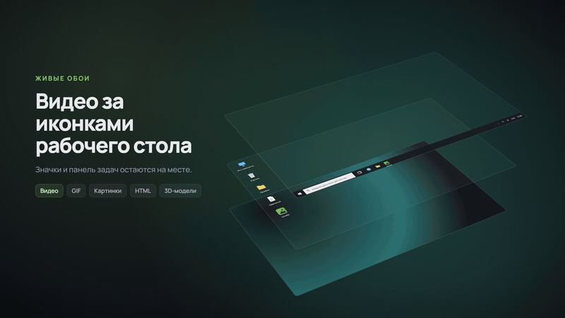

# LimeKit

**English** · [Русский](README.md)

A Windows customization kit you can undo.

I started this as a live wallpaper app called LimeWall. The wallpapers worked out
well and I use them every day, but somewhere along the way I realised the picture
on my desktop wasn't the only thing I wanted to change about Windows. So LimeWall
became LimeKit: same engine underneath, but now it's a kit that will grow.

Wallpapers are the first module and the only finished one. Everything else is in
the plans below, and I've written them honestly — what's done is done, what
isn't, isn't.

<!-- GIF GOES HERE: live wallpaper behind the icons with the app window beside
     it. Drop the file in docs/media/ and replace this comment with
      -->

## What works today

**Live wallpapers** behind the desktop icons — video, GIF, images, HTML pages
and glTF 3D models.

- Hardware decoding through libmpv and d3d11va. On my machine 1080p H.264 sits
  between 1.5% and 5% CPU, and exactly 0% when paused.
- GPU upscaling when the source is smaller than the monitor: lanczos, FSR, or
  Anime4K for drawn content. If the source already matches the monitor, no
  shader runs — there's no reason to heat the GPU for nothing.
- Per-monitor quality, volume and playlist settings. Playlists keep rotating
  after you close the window.
- Wallpapers pause themselves when they shouldn't be running: a fullscreen game
  in focus, a locked screen, the display off, the laptop on battery. I tested it
  against a real game — the pause lands within a couple of seconds and the CPU
  drops to zero. A separate watchdog also stops any wallpaper that runs the CPU
  hot for too long.
- `.limekit` packages — export anything from your library as one file, install
  someone else's with a double-click. Older `.wpk` files from 0.1 still open.
- A community catalog inside the app; downloads are checksum-verified.

## Where this is going

In order, not by importance:

1. **System tweaks** — toggles for the taskbar, File Explorer, appearance and
   privacy. Each one shows exactly what it will change before it does, and
   reverts in one click. The whole change-journal design exists for this.
2. **Themes** — cursors, sounds, accent colours, folder icons. Build a set,
   share it as a file, put everything back the way it was.
3. **Widgets and a dock** — a clock, a system monitor, notes on the desktop; a
   dock of my own through the documented AppBar API, without touching the
   system taskbar.

I'm not promising dates: this is spare-time work, around ten hours a week. But
that's the order, and it won't change quietly — watch the releases.

## What LimeKit does not do

This isn't a list of shortcomings. These are deliberate choices, and most
Windows customization tools break systems through exactly what's absent here.

- **No code injection into system processes.** Not `explorer.exe`, not
  `dwm.exe`, nowhere. That takes away the usual reasons for anti-cheat trouble
  and for Explorer crash loops after a Windows update. It doesn't make LimeKit
  immune to updates, though: drawing behind the icons relies on an
  undocumented trick, and in 2024–2025 Microsoft held back the 24H2 upgrade on
  PCs with wallpaper apps. Details in
  [the layer behind the icons](docs/research/workerw.md).
- **No patching of system files.** `System32` stays the way Microsoft shipped
  it. SFC and DISM will find nothing to complain about.
- **Nothing gets weakened.** Defender, UAC, SmartScreen, Windows Update —
  none of my business. Any "optimizer" that touches those makes you less safe.
- **No administrator rights.** Everything lives in your own profile:
  `%APPDATA%` and `HKCU`. Other users of the machine never see LimeKit.
- **No code fetched from the network.** An update is a release you download
  yourself, not a script that arrives at runtime.

One honest exception: a web wallpaper is a real HTML page and JavaScript does
run in it. So it gets a strict CSP that closes off network access, and
installing such a package asks for confirmation first. How that works, and what
I deliberately don't try to detect, is in the
[security model](docs/research/security-model.md).

## What goes online

No telemetry, no analytics, no crash reports sent anywhere. LimeKit talks to the
network in two cases, and only to GitHub (`raw.githubusercontent.com`,
`github.com`, `objects.githubusercontent.com`):

- when you open the **Catalog** tab, to fetch the list of wallpapers and the
  ones you choose to download;
- when the window starts, but only if your library has wallpapers from the
  catalog: it fetches the revocation list so a wallpaper pulled for being
  harmful gets removed from your machine too.

The diagnostics report in settings is copied to your clipboard when you press
the button. Where it goes after that is up to you.

## Install

Windows 10 or 11, 64-bit. Nothing else to install — it's all in the archive.
(Versions before 0.2.1 also needed a graphics driver with Vulkan support.)

1. Download the archive from
   [Releases](https://github.com/sweety1lime/limekit/releases).
2. Unpack it anywhere.
3. Run `LimeKit.exe`.

There's no installation, but LimeKit does leave two things in the current
user's registry: the `.limekit` file association, which the window writes when
it starts, and the autostart entry, if you turn autostart on. To uninstall, hit
"Remove LimeKit from the system" in settings: the wallpapers stop, both entries
go, and the wallpaper library too if you want. Then delete the folder.

LimeKit has no website and no mirrors. The only place to download it is
[Releases](https://github.com/sweety1lime/limekit/releases) of this
repository. Fake download sites for popular Windows tools regularly outrank the
real ones in search results, so if some site offers "LimeKit download", it isn't
me.

**About the Windows warning.** Releases aren't signed with a certificate yet, so
the first launch shows "Windows protected your PC". That's not a sign of a virus
— it's the absence of a paid certificate, which costs money and isn't available
everywhere. The SHA-256 of the archive and of the programs inside it are in the release
notes and in a `SHA256SUMS.txt` next to the archive, so you can check you
downloaded my build. Since 0.2.1, releases are built by GitHub Actions, and
with the [GitHub CLI](https://cli.github.com/) installed,
`gh attestation verify LimeKit-<version>-win64.zip -R sweety1lime/limekit`
shows which workflow and commit produced the archive. On Windows 11 with Smart
App Control turned on, an unsigned
build may not start at all. When signing happens, I'll say so in a release.

**Upgrading from LimeWall 0.1.** Just run LimeKit. It asks the old version to
quit, moves your library and settings from `%APPDATA%\LimeWall` to
`%APPDATA%\LimeKit`, and takes over autostart if you had it on. Any `.wpk` files
you've already shared still open. If the old version is frozen and won't quit,
close it from the tray and start LimeKit again.

## How it's built

The architecture in short: two processes. A long-lived daemon owns the wallpaper
surfaces and playback; the Tauri window is control only, and closing it doesn't
stop the wallpapers. They talk over local IPC. Everything platform-specific sits
behind the `WallpaperHost` trait in `crates/platform`.

If you care about what's behind the button, I keep notes, including the options
I rejected and why. They're in Russian:

- [Architecture](docs/research/architecture.md) — the daemon, the window and
  the IPC protocol between them.
- [Security model](docs/research/security-model.md) — why I bet on containment
  instead of trying to detect hostile content.
- [The layer behind the icons](docs/research/workerw.md) — how you draw behind
  desktop icons at all, and what Windows 11 24H2 changed.
- [Renderer isolation](docs/research/renderer-sandbox.md) — why a full
  AppContainer didn't fit, and what I do instead.
- [Community catalog](docs/research/catalog.md) — moderation, checksums,
  revocation.
- [Politeness](docs/research/politeness.md) — when and how wallpapers pause.
- [Tweak journal](docs/research/tweaks-journal.md) — how the upcoming tweaks
  write down every change before making it, and how it is undone.

## Decisions and trade-offs

**Two processes instead of one app.** The wallpapers live in a daemon, and the
window is a separate program you can close at any time; the tray belongs to the
daemon too. The price is two processes and a protocol between them that has to
survive an old window talking to a new daemon.

**An undocumented trick instead of an official API.** Windows has no API for
drawing behind the desktop icons, so LimeKit uses the same `WorkerW` trick as
every other wallpaper app, with two search paths (before and after 24H2) and a
watchdog that re-attaches the window when Explorer rebuilds the desktop. It can
break with any Windows update, and I can only promise to fix it quickly, not
that it won't happen.

**My own thin libmpv bindings instead of the `libmpv2` crate.** About 17
function declarations, loaded at runtime with `libloading`. The renderer builds
without the dll, and `libmpv-2.dll` stays a separate file you can replace, which
is what its LGPL license asks for. The price: when mpv's API changes, I update
the declarations by hand.

**A bundled Vulkan loader as a fallback, not a replacement.** libmpv and ffmpeg
import `vulkan-1.dll`, which Windows doesn't have: the graphics driver installs
it. So that LimeKit also works where the driver didn't (old Intel HD graphics,
virtual machines), the archive carries the Khronos loader, signed by LunarG, in
a separate `vulkan` folder, and it's used only when System32 has none. Khronos
advises against replacing the system loader, since an old copy may not get
along with newer drivers. The price: 1.7 MB more in the program folder, and
keeping that copy up to date is on me.

**Containment instead of detection.** I don't try to scan wallpapers for
malware; a determined author would get past any scanner. Instead a web wallpaper
has no network and no bridge to native code, and a watchdog pauses any wallpaper
that keeps the CPU busy. The catalog only accepts video and images. The price:
wallpapers that genuinely need the network (weather, live data) aren't possible.

**Process mitigations instead of a full sandbox.** A process in an AppContainer
can't attach its window to Explorer's desktop window, so the renderer can't be
locked down as a whole. It runs with the mitigations that don't break libmpv and
WebView2, plus Control Flow Guard. Moving the video decoder into a separate
sandboxed process is designed, but it's weeks of work and isn't done.

**GitHub pull requests instead of a server for the catalog.** No backend to pay
for or keep alive, and every pack gets reviewed before anyone sees it. The
price: a new wallpaper appears only after I've reviewed it.

**A portable zip instead of an installer, no auto-update.** In the registry
LimeKit leaves only the `.limekit` association and autostart; its files live in
`%APPDATA%\LimeKit` and the window's cache in
`%LOCALAPPDATA%\com.twofame.limekit`. One button in settings removes all of it,
and after that removing LimeKit means deleting a folder.
The price: the unsigned build gets a SmartScreen warning, updates are manual,
and after you move the folder autostart points at the old place until you turn
it off and on again (the window fixes the association itself when it starts).

**GitHub Actions builds the release, not my laptop.** Since 0.2.1 the release
archive is built on a clean machine without caches, through `cargo auditable`,
passes a smoke test on Windows Server 2022 and 2025, and gets a build
attestation and an SBOM. Anyone can check it was built from this repository
rather than on a computer nobody looked into. The price: a release build takes
about 20 minutes, and Windows Server isn't Windows 11, so wallpapers on 11 are
still checked by hand.

**No telemetry.** I don't know how many people use LimeKit or what crashes for
them. Bugs reach me only through issues with the diagnostics report attached.

## Build from source

You'll need Rust and Node. First, once — the playback runtimes (LGPL builds and
the Vulkan loader) and their license texts; details in
[docs/third-party.md](docs/third-party.md):

```
scripts\fetch-libmpv.ps1
scripts\fetch-ffmpeg.ps1
scripts\fetch-vulkan-loader.ps1
scripts\fetch-licenses.ps1
```

Daemon and CLI:

```
cargo run -p renderer -- play video.mp4 --monitor 0 --quality max
cargo run -p renderer -- serve
cargo run -p renderer -- ctl play video.mp4 --monitor 0 --quality max
cargo run -p renderer -- ctl pause | resume | volume 30 | status | shutdown
```

Control window:

```
cd apps/ui
npm install
npm run tauri dev
```

Windows PowerShell 5 has no `&&`, so run the commands one per line. The first
`npm run tauri dev` compiles the whole Tauri stack and can think for several
minutes.

`tauri dev` serves the frontend from a dev server and can't exercise the real
lifecycle: closing the window, reopening from the tray, autostart, a reboot. For
that, build the portable folder — every binary side by side, nothing required:

```
scripts\build-portable.ps1
```

The result lands in `dist/LimeKit/`; run `dist\LimeKit\LimeKit.exe`.

`scripts\smoke-test.ps1 -Dir dist\LimeKit` checks that the folder has every
file it needs, that its ffmpeg can build a `.limekit` package, and that the
background process shows a video and a web page and shuts down cleanly. Test
wallpapers flash on your desktop while it runs. GitHub Actions
([build.yml](.github/workflows/build.yml)) runs the same on every push: the
checks, the build, and this test on the unpacked zip on Windows Server 2022 and
2025.

## Licensing

LimeKit's own code is [GPL-3.0](LICENSE).

libmpv and ffmpeg are used as **LGPL** builds, dynamically linked. The FSR and
Anime4K shaders are MIT and BSD. Pinned versions and sources are listed in
[docs/third-party.md](docs/third-party.md) and
[licenses/THIRD-PARTY-NOTICES.md](licenses/THIRD-PARTY-NOTICES.md).

## Bugs and ideas

Found something broken?
[Open an issue](https://github.com/sweety1lime/limekit/issues). The bug template
asks for the diagnostics report from the app (there's a button in settings) and
your Windows version — without those I usually can't reproduce the problem.
